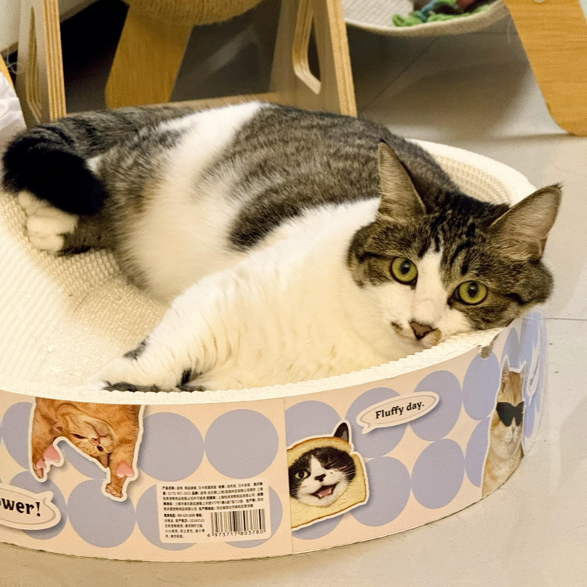

# Hi, I'm Xiaoxue!

I'm a second-year MPH student in Epi Departiment at Columbia University Mailman School of Public Health. My interests are in cancer epidemiology, applied research, and data analysis. 

This site includes a little about my background and some of my coursework. 

To learn more about myself, go [here](resume.html)

My cat, who is unfortunately not in New York with me: 

